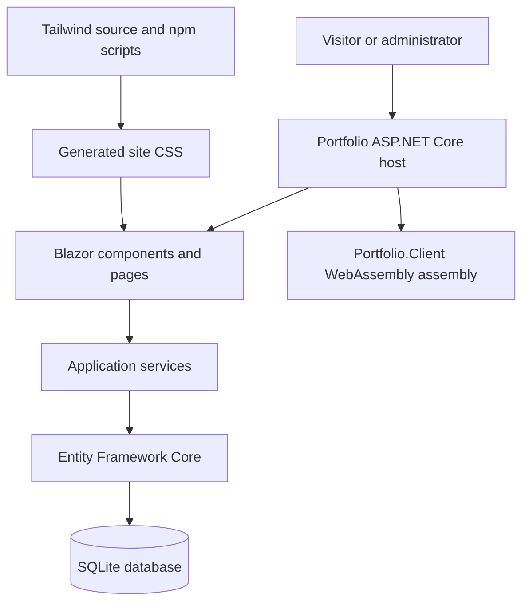

<div align="center">

# Veyora Portfolio Platform

**A full-stack personal portfolio and private workspace, built with Blazor.**

A polished public portfolio, project case studies, contact and booking flows, plus a protected admin area for managing messages, availability, bookings, and tasks.

[Overview](#overview) · [Features](#features) · [Architecture](#architecture) · [Get started](#get-started) · [Configuration](#configuration) · [Operations](#operations)


</div>

---

## Contents

- [Overview](#overview)
- [Features](#features)
- [Architecture](#architecture)
- [Repository layout](#repository-layout)
- [Get started](#get-started)
- [Configuration](#configuration)
- [Database](#database)
- [Development workflow](#development-workflow)
- [Where to make changes](#where-to-make-changes)
- [Security notes](#security-notes)
- [Troubleshooting](#troubleshooting)

## Overview

Veyora is a .NET 8 Blazor Web App with both server and WebAssembly interactivity. Its public-facing pages present profile information, selected work, project details, career history, and contact options. The same application also includes authenticated administration pages for day-to-day portfolio operations.

The solution is intentionally split into two .NET projects:

- **`Portfolio`** is the ASP.NET Core host. It serves the app, configures authentication and security middleware, owns persistence, and contains most UI, domain models, and application services.
- **`Portfolio.Client`** is the Blazor WebAssembly client assembly. It is referenced by the host and participates in interactive WebAssembly rendering.

Tailwind CSS is compiled from source with the npm scripts in the host project. SQLite is the default local database.

## Features

### Public portfolio

- Responsive home page with hero, about, skills, projects, timeline, and contact sections.
- Individual project pages with case-study content.
- Server-side validation for contact submissions.
- Booking and availability experience.

### Administration

- Cookie-authenticated admin area and login/logout pages.
- Management panels for messages, bookings, availability, and todo items.
- Settings and password credential models.
- Passkey login for the admin account. The device (for example, Touch ID, Face ID, or Windows Hello) verifies the user locally; the site verifies a cryptographic response and does not receive the fingerprint or face data.

### Platform

- Blazor Server and WebAssembly render modes.
- SQLite persistence through Entity Framework Core.
- Database seeding and checked-in EF Core migrations.
- Security headers, HTTPS redirection, forwarded-header support, and rate limiting for form submissions.
- Tailwind CSS build and watch workflows.

## Architecture



### Request and UI flow

1. ASP.NET Core starts from `Portfolio/Program.cs`, loads configuration, registers services, and ensures the data directory exists.
2. The database seeder initializes required records when the host starts.
3. `Components/Routes.razor` and the pages under `Components/Pages` provide the app routes.
4. Pages compose reusable UI from `Components/Layout`, `Components/Sections`, and `Components/Admin`.
5. UI components call interfaces in `Services`; implementations handle portfolio data, contact submissions, bookings, availability, authentication, and todo operations.
6. Entity Framework Core maps persisted data through `Data/AppDbContext.cs`; migrations in `Migrations` describe schema changes over time.

### Render modes

The host registers interactive server and WebAssembly components. `Components/Routes.razor` selects render modes for the app's routed UI. The client project is included as an additional assembly by the host, so components intended for WebAssembly can live in `Portfolio.Client` while server-only behavior remains in the host.

## Repository layout

```text
.
├── Portfolio.sln                 # Open/build the complete solution
├── Portfolio.Client/             # Blazor WebAssembly client assembly
│   ├── Program.cs
│   ├── _Imports.razor
│   └── Portfolio.Client.csproj
└── Portfolio/                    # ASP.NET Core host and main application
    ├── Components/
    │   ├── Admin/                # Admin panels and settings
    │   ├── Layout/               # Shared layouts, header, and footer
    │   ├── Pages/                # Routable pages
    │   └── Sections/             # Public portfolio sections and project views
    ├── Data/                     # EF Core context and database seeder
    ├── Migrations/               # EF Core schema history
    ├── Models/                   # UI and persistence models
    ├── Security/                 # Security headers and rate-limit policies
    ├── Services/                 # Service interfaces and implementations
    ├── Styles/input.css          # Tailwind input stylesheet
    ├── wwwroot/                  # Static assets, scripts, and compiled CSS
    ├── appsettings*.json         # Host configuration
    └── Portfolio.csproj
```

Generated build output (`bin`, `obj`, publish folders), local npm dependencies, and local SQLite database files are excluded from version control.

## Get started

### Requirements

- .NET 8 SDK
- Node.js and npm (only needed to build or watch Tailwind CSS)

Check your installed tools:

```bash
dotnet --version
node --version
npm --version
```

### First run

From the repository root:

```bash
# Restore the .NET solution
dotnet restore Portfolio.sln

# Install the CSS toolchain
cd Portfolio
npm ci

# Compile Tailwind CSS
npm run build:css

# Start the application
dotnet run
```

The terminal prints the local listening URL(s), typically `https://localhost:7058` and/or `http://localhost:5063`. Open the URL shown by `dotnet run`.

To run from the repository root instead, specify the host project:

```bash
dotnet run --project Portfolio/Portfolio.csproj
```

### Useful commands

Run these from the repository root unless noted otherwise:

```bash
# Build both projects
dotnet build Portfolio.sln

# Run the host
dotnet run --project Portfolio/Portfolio.csproj

# Build Tailwind CSS (run from Portfolio/)
cd Portfolio && npm run build:css

# Watch and rebuild CSS while editing Razor/CSS (run from Portfolio/)
cd Portfolio && npm run watch:css
```

For a smoother frontend workflow, leave `npm run watch:css` running in one terminal and `dotnet watch --project Portfolio/Portfolio.csproj` running in another. Stop either process with `Ctrl+C`.

## Configuration

The host reads standard ASP.NET Core configuration sources, including `Portfolio/appsettings.json`, `Portfolio/appsettings.Development.json`, environment variables, and user secrets.

The first administrator is created only when both `Admin:Username` and `Admin:Password` are configured and the database has no admin account yet. Configure them locally with user secrets before the first run:

```bash
dotnet user-secrets init --project Portfolio/Portfolio.csproj
dotnet user-secrets set "Admin:Username" "your-admin-name" --project Portfolio/Portfolio.csproj
dotnet user-secrets set "Admin:Password" "use-a-long-unique-password" --project Portfolio/Portfolio.csproj
```

Keep the password out of `appsettings*.json`, source control, and shell history on shared machines. If the database already contains an admin, changing these settings will not reset that account's password.

### Database connection

The default connection string is configured as `ConnectionStrings:DefaultConnection` and points to `Data/app.db` relative to the host's content root. Override it with an environment variable when needed:

```bash
ConnectionStrings__DefaultConnection="Data Source=Data/app.db" dotnet run --project Portfolio/Portfolio.csproj
```

### WebAuthn / FIDO2

Configure `Fido2:ServerDomain`, `Fido2:ServerName`, and `Fido2:Origins` for the domain where the site is served. The origin must match the browser origin exactly, including scheme and port for local development. Local defaults are registered in code for localhost; production should use the real HTTPS origin.

For local overrides, use environment variables or .NET user secrets rather than committing machine-specific values:

```bash
dotnet user-secrets init --project Portfolio/Portfolio.csproj
dotnet user-secrets set "Fido2:ServerDomain" "localhost" --project Portfolio/Portfolio.csproj
dotnet user-secrets set "Fido2:Origins:0" "https://localhost:7058" --project Portfolio/Portfolio.csproj
```

If you change the development URL, update the origin configuration to match it.

## Database

The application uses SQLite through Entity Framework Core. The host creates the `Data` directory and runs the database seeder at startup. The repository contains EF Core migrations under `Portfolio/Migrations`.

Restore the repository-local EF command-line tool from the manifest at `.config/dotnet-tools.json`:

```bash
dotnet tool restore
```

Create and apply a migration from the repository root:

```bash
dotnet ef migrations add DescribeYourChange \
  --project Portfolio/Portfolio.csproj \
  --startup-project Portfolio/Portfolio.csproj

dotnet ef database update \
  --project Portfolio/Portfolio.csproj \
  --startup-project Portfolio/Portfolio.csproj
```

The local database is application data and is ignored by Git. Keep a backup before manually replacing or deleting it.

## Development workflow

1. Start Tailwind in watch mode from `Portfolio/`:
   ```bash
   npm run watch:css
   ```
2. Start the .NET app from the repository root:
   ```bash
   dotnet watch --project Portfolio/Portfolio.csproj
   ```
3. Edit the relevant component, service, model, or style source.
4. Before sharing changes, produce a clean CSS build and compile the solution:
   ```bash
   cd Portfolio && npm run build:css
   cd .. && dotnet build Portfolio.sln
   ```

Tailwind scans the configured source files and writes the compiled stylesheet to `Portfolio/wwwroot/css/site.css`. Edit `Styles/input.css` for global Tailwind directives and custom CSS; do not treat generated output as the source of truth.

## Where to make changes

| Goal | Start here |
| --- | --- |
| Update name, profile, or skills | `Portfolio/Services/ProfileService.cs` |
| Add or edit portfolio projects | `Portfolio/Services/ProjectService.cs`, `Portfolio/Models/Project.cs` |
| Change career history | `Portfolio/Services/TimelineService.cs`, `Portfolio/Models/TimelineEntry.cs` |
| Change home page sections | `Portfolio/Components/Pages/Home.razor`, `Portfolio/Components/Sections/` |
| Change project details | `Portfolio/Components/Pages/ProjectDetail.razor`, `Portfolio/Components/Sections/ProjectDetailContent.razor` |
| Change contact handling | `Portfolio/Services/ContactService.cs`, `Portfolio/Components/Sections/Contact.razor` |
| Change bookings or availability | `Portfolio/Services/BookingService.cs`, `Portfolio/Services/AvailabilityService.cs`, `Portfolio/Components/Admin/` |
| Change admin authentication | `Portfolio/Services/AuthService.cs`, `Portfolio/Components/Pages/Login.razor` |
| Change persistence or schema | `Portfolio/Data/AppDbContext.cs`, `Portfolio/Migrations/` |
| Change security headers or throttling | `Portfolio/Security/`, `Portfolio/Services/FormSubmissionRateLimitService.cs`, `Portfolio/Program.cs` |
| Change browser-side behavior | `Portfolio/wwwroot/js/` |
| Change styling | `Portfolio/Styles/input.css`, component `.razor.css` files, `Portfolio/tailwind.config.js` |

## Security notes

- Production cookies are configured as secure, HTTP-only, and `SameSite=Strict`.
- HTTPS redirection and HSTS are enabled outside Development.
- Form submission rate limiting and security headers are configured by the host.
- Set FIDO2 relying-party values to the deployed domain and HTTPS origin before enabling production use.
- Do not commit credentials, production databases, private keys, or machine-specific configuration.

## License

This repository uses a custom view-only license. It is public so people can inspect the project, but it is not an open-source license and does not grant general permission to reuse, modify, or redistribute the code. See [`LICENSE`](LICENSE) for the terms. GitHub's own terms still govern viewing and use of GitHub features such as forking.

## Troubleshooting

**The browser shows unstyled content.** Run `npm ci` and `npm run build:css` from `Portfolio/`, then restart or refresh the app.

**`npm` is not found.** Install Node.js (which includes npm), open a new terminal, and retry `node --version` and `npm --version`.

**The app cannot find the database.** Start the host project from the repository or use the `--project` command above. The default SQLite path is relative to the host content root; the host creates its `Data` directory at startup.

**WebAuthn reports an origin or domain mismatch.** Ensure the FIDO2 domain and allowed origin match the URL in the browser. Scheme, hostname, and port must line up with the active environment.

**A Tailwind class does not appear in the page.** Confirm the file is included by `tailwind.config.js`, then run the CSS watcher or rebuild the stylesheet.

---

<div align="center">

Built with .NET, Blazor, Tailwind CSS, and SQLite.

</div>
